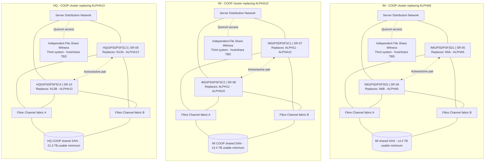

# GDPS COOP Network Node Diagram

ServiceNow environment: **COOP** for all six nodes. The ALPHA6 replacement pair resides at **IM**; the ALPHA10 replacement pair is at **IM**, and the ALPHA13 replacement pair is at **HQ**. These are three separate two-node clusters.

These are logical node and connectivity diagrams. Each server box contains both the new hostname and its replacement relationship. Network links represent redundant Server Distribution connectivity; storage paths use two independent Fibre Channel fabrics with Windows MPIO. The witness resides on a third independent system, outside the cluster nodes and their shared storage. Assigned network IPs, VLANs, switch ports, WWPNs and zoning remain with the infrastructure teams.

COOP replication sources, targets, direction, topology, technology, and schedule are to be determined by GPO network engineers. Each cluster requires its own independent witness share; witness host placement is TBD.

| Replacement cluster | Location | Storage request | Shared SAN baseline |
|---|---|---|---|
| ALPHA6 replacement | IM | ST-03 | 14.4 TB usable minimum |
| ALPHA10 replacement | IM | ST-04 | 14.4 TB usable minimum |
| ALPHA13 replacement | HQ | ST-05 | 21.4 TB usable minimum |

ALPHA13 members N13A and N13B are confirmed by `SHOW CLUSTER`; their interfaces are confirmed by `TCPIP SHOW INTERFACE`. The approved new hostnames containing `FSD` remain unchanged even though the ServiceNow environment is COOP.

Source: [current physical server tickets](../07%20Server%20Requests/v8%2010-Node%20Physical%20Server%20Tickets/).
