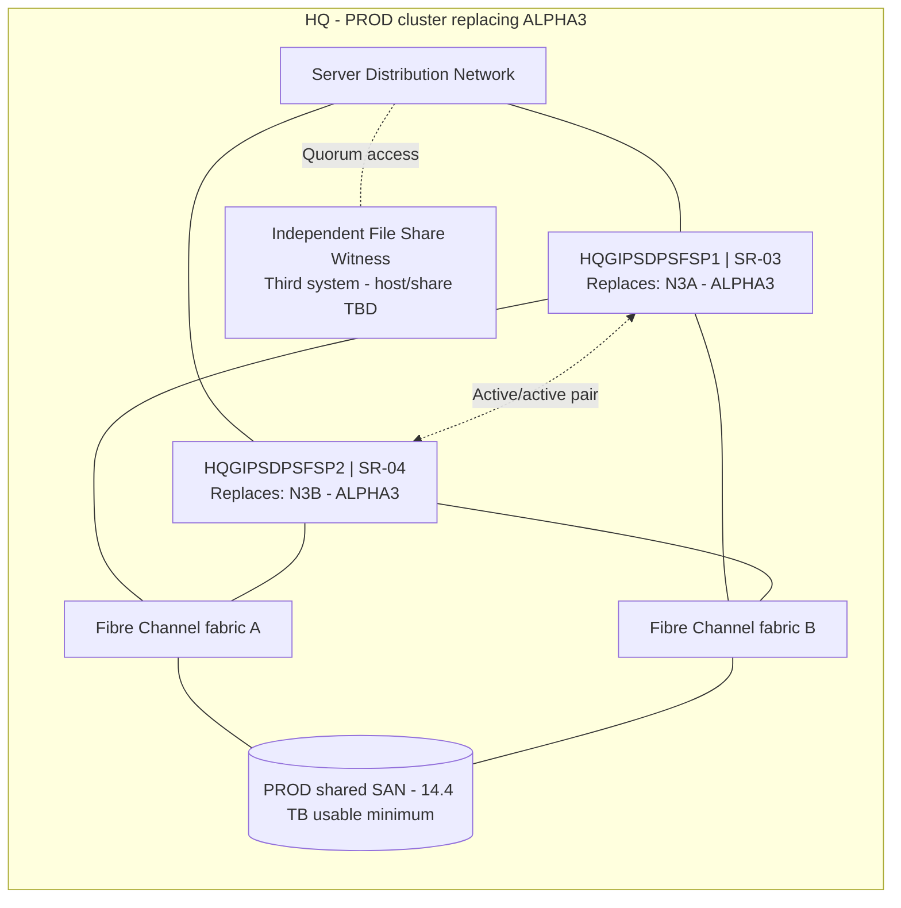

# GDPS PROD Network Node Diagram

Location: **HQ**. ServiceNow environment: **PROD**. Replaces the two physical nodes of **ALPHA3**.

These are logical node and connectivity diagrams. Each server box contains both the new hostname and its replacement relationship. Network links represent redundant Server Distribution connectivity; storage paths use two independent Fibre Channel fabrics with Windows MPIO. The witness resides on a third independent system, outside the cluster nodes and their shared storage. Assigned network IPs, VLANs, switch ports, WWPNs and zoning remain with the infrastructure teams.

Storage request: **ST-02**. COOP replication sources, targets, direction, topology, technology, and schedule are to be determined by GPO network engineers.

Source: [current physical server tickets](../07%20Server%20Requests/v8%2010-Node%20Physical%20Server%20Tickets/).
