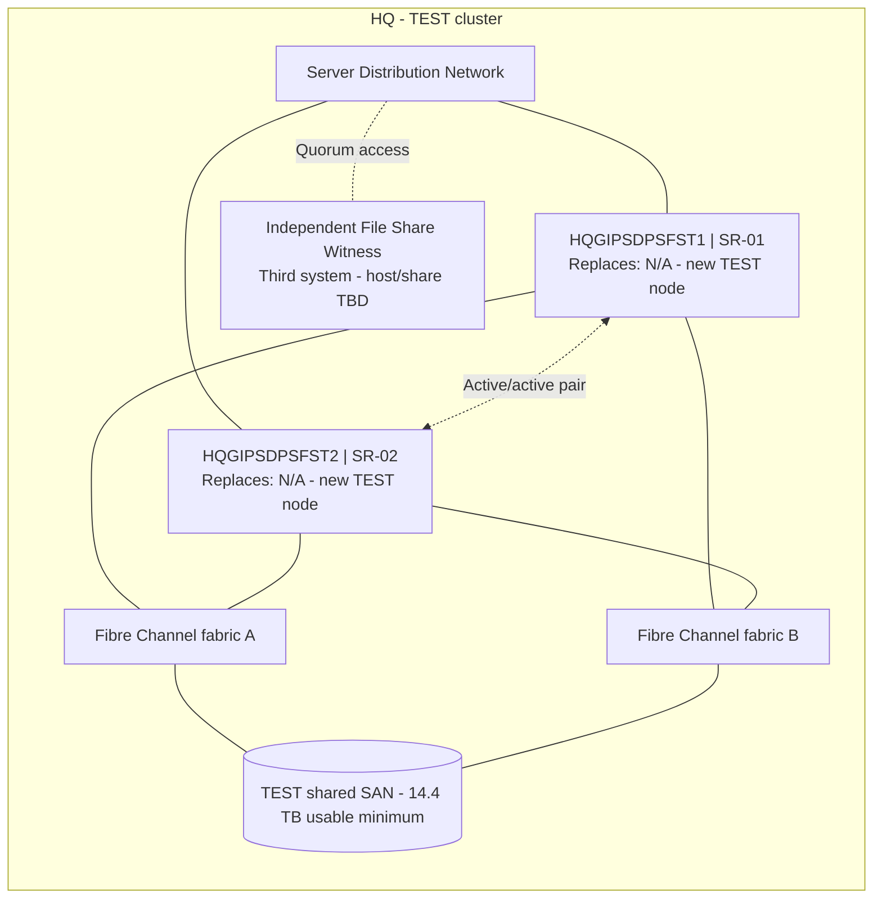

# GDPS TEST Network Node Diagram

Location: **HQ**. ServiceNow environment: **Test**. Both physical nodes are new; neither replaces an existing Alpha node.

These are logical node and connectivity diagrams. Each server box contains both the new hostname and its replacement relationship. Network links represent redundant Server Distribution connectivity; storage paths use two independent Fibre Channel fabrics with Windows MPIO. The witness resides on a third independent system, outside the cluster nodes and their shared storage. Assigned network IPs, VLANs, switch ports, WWPNs and zoning remain with the infrastructure teams.

Storage request: **ST-01**. TEST validates the existing Alpha production cluster, storage, failover and recovery behavior before release.

Source: [current physical server tickets](../07%20Server%20Requests/v8%2010-Node%20Physical%20Server%20Tickets/).
