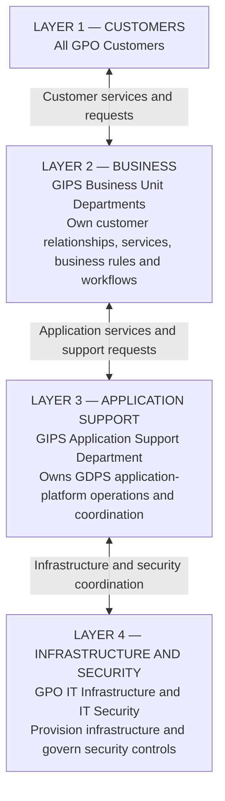
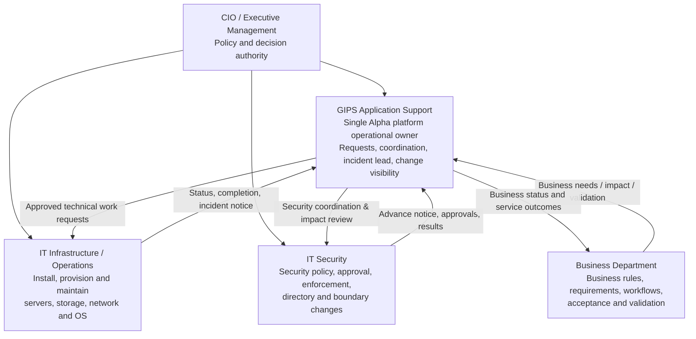
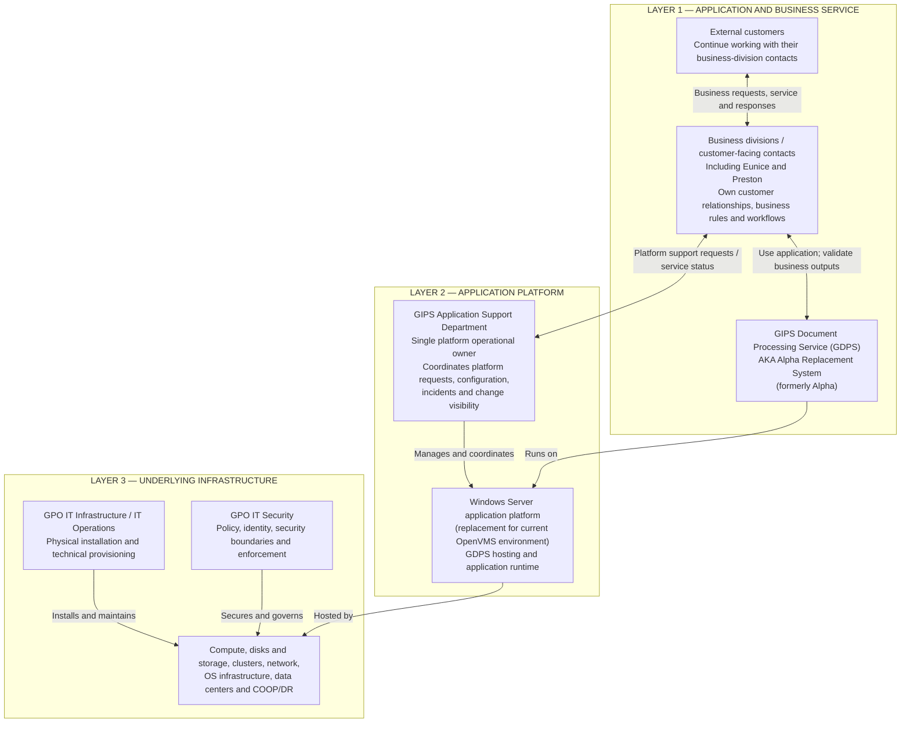

# Executive Decision Brief — Alpha Platform Operational Ownership

**Decision requested:** Approve an **immediate** transfer of application-platform operational ownership and coordination to **GIPS Application Support** for the existing Alpha/OpenVMS environment and the Windows-based GDPS replacement program.  
**Audience:** Ravinder Birdi (Managing Director), Sam (CIO), Nadine (IT Operations Chief).  
**Date:** November 6, 2026 | **Status:** Proposed; not yet approved.

## Four-layer service relationship — executive overview

This simple diagram shows **who serves whom**, from all GPO customers through the supporting technical organizations. It complements, rather than replaces, the responsibility and three-layer architectural diagrams above.

**Interpretation:** All GPO customers continue to work with GIPS business unit departments, including their existing customer-facing contacts. Those departments interface with GIPS Application Support for GDPS platform services. GIPS Application Support coordinates with GPO IT Infrastructure and IT Security for physical infrastructure and security support. The diagram represents service relationships, **not** a transfer of business-customer relationships to Application Support or a transfer of IT Security's independent policy authority.

**Platform patching clarification:** Where GPO IT Security delegates operating-system or application-platform patch execution to the designated platform owner, GIPS Application Support coordinates and performs that assigned responsibility within approved security policy and change-control procedures. GPO IT Security retains policy, oversight and enforcement; responsibility for particular patches remains subject to documented assignment and technical access.

## Decision statement
Upon approval, **GIPS Application Support shall be the single accountable operational owner and coordination point for Alpha application-platform activities**, including service requests, server and storage acquisition requests, application configuration, COOP/DR coordination, access-impact reviews, change visibility, incident ownership, and modernization alignment.

**IT Infrastructure** remains responsible for physical installation, compute/storage/network provisioning, operating-system infrastructure and implementation of assigned infrastructure changes. **IT Security** retains security policy, independent security approvals, directory/security-group administration, and enforcement. **Business departments** own business processes, business requirements, workflow rules, acceptance criteria and business validation. They will request assistance through GIPS Application Support rather than independently ordering equipment or initiating platform modifications.

This is a change to **operational governance**, not a redesign of business processing. POLLVAX continues to govern the business behavior ported to APDMS.

## Why immediate
- **Duplicate spending risk:** The Windows replacement procurement is underway while separate requests to replace aging Alpha hardware have also been initiated.
- **Uncoordinated changes:** A security-boundary/group change reportedly affected access without sufficient application support visibility, leading to user login and mapped-drive incidents. The circumstances and authorization require verification.
- **Service accountability gap:** Users report availability/access problems to application support, but relevant infrastructure and security changes may be undertaken elsewhere without timely coordination.

## Executive responsibility diagram

## Three-layer service ownership diagram — GDPS

The replacement application is named **GIPS Document Processing Service (GDPS)**, also known as the **Alpha Replacement System** (formerly **Alpha**). Use **GDPS** as the forward-looking system name; **Alpha/OpenVMS** identifies the legacy system and historical dependencies.

The application layer deliberately distinguishes **external customers** from the **business divisions** that serve them. Eunice and Preston are shown as existing customer-facing business contacts, not as platform administrators. Their precise titles and organizational assignments are to be confirmed.

**Customer-facing boundary:** External customers continue to interface with their established business divisions and contacts, including Eunice and Preston. The business divisions remain accountable for customer service, business requirements and business workflows. **GIPS Application Support interfaces with those divisions for platform operations; it does not replace their customer relationships.** The business divisions do not independently administer or procure hardware, storage, server configuration or platform security changes.

**Technical ownership boundary:** GIPS Application Support is the operational platform owner and coordinates Alpha/GDPS technical requests. GPO IT Infrastructure performs authorized physical and infrastructure work; GPO IT Security retains security decisions and implementation authority. Planned access, drive or security-boundary changes are coordinated with Application Support, without delaying emergency security actions.

**Core rule:** GIPS Application Support is accountable for coordination and application-service outcomes; supporting technical organizations execute their own authorized functions. No technical approval, emergency security authority, or segregation-of-duties control is bypassed.

## Immediate leadership directions proposed
1. Designate GIPS Application Support the Alpha platform point of entry for **all new legacy and replacement environment requests**, effective upon authorization.
2. Direct business units to **stop independently initiating Alpha hardware purchases, storage changes or security/configuration requests**; route them through Application Support. Review existing orders individually rather than cancelling automatically.
3. Reconcile existing Alpha maintenance/replacement requests with the GDPS Windows procurement program and identify duplicate or unnecessary expenditure before further commitments.
4. Direct IT Infrastructure and IT Security to notify and coordinate **planned Alpha-impacting changes** with Application Support before implementation, with documented exceptions for urgent security incidents and mandatory controls; communicate emergency actions promptly.
5. Establish a current inventory of Alpha service accounts, security groups/boundaries, access paths, dependent drives/shares, COOP/DR obligations, and service-request owners.
6. Approve the detailed operating model, fill role-based contacts and announce the ownership decision to all stakeholders.

## Existing replacement baseline
The hardware library states **10 physical Windows servers**, arranged in five two-node clusters for **TEST, PROD, DR, COOP IM, and COOP HQ**. **DEV** is a separate virtual-server replacement. The authoritative request set is in `Hardware replacment/07 Server Requests/v8 10-Node Physical Server Tickets/`; the controlled-document register governs procurement. This governance change covers **the existing Alpha system immediately**, not only the future Windows environment.

## Approval record
- Managing Director, Ravinder Birdi — Decision/endorsement: **[Pending]**
- CIO, Sam — Authorization: **[Pending]**
- IT Operations Chief, Nadine — Infrastructure operations acknowledgment: **[Pending]**
- GIPS Application Support platform lead — Named owner: **[To assign]**
- Effective timestamp and communication record: **[Pending]**

See [Detailed Operating Model](02_Detailed_Operating_Model.md) and [Contacts Matrix](03_Contacts_and_Responsibility_Matrix.md).
