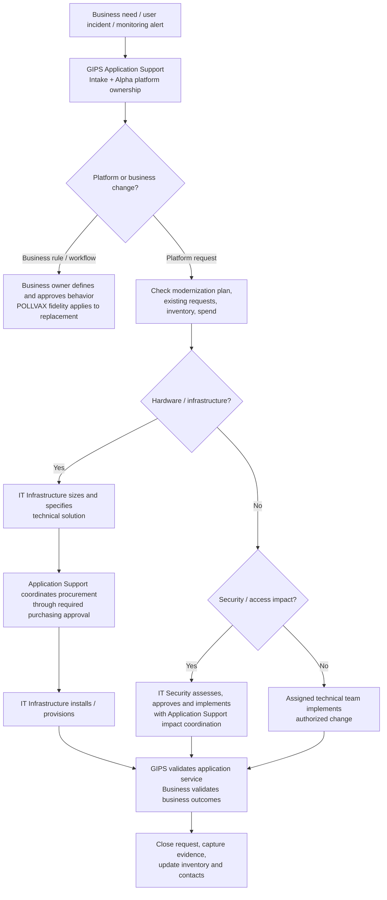

# Detailed Operating Model — Existing Alpha and GDPS Replacement

**Version:** Draft 1.0 | **Prepared:** November 6, 2026  
**Status:** Immediate change **proposed**, effective only after authorized management decision.

## 1. Purpose and scope
Provide a single coordination and accountability model for the **existing Alpha/OpenVMS application platform** while the replacement GDPS Windows systems are procured, installed, validated and cut over. Scope includes legacy availability, users and drive access, servers, procurement, storage, network and SMB, directory/security boundaries, COOP/DR, operational changes, incidents and replacement-program alignment.

This proposal changes organizational responsibilities, **not** POLLVAX domain business rules or the approved APDMS processing architecture.

## 2. Authority and operating boundaries

### GIPS Application Support — platform operational owner
- Single intake and coordination authority for Alpha platform requests, operational incidents, business-unit technical needs and modernization alignment.
- Consolidates hardware requirements, determines whether legacy repair/replacement is justified, initiates or coordinates purchase requests under existing procurement rules, and tracks costs, tickets, status and dependencies.
- Coordinates infrastructure/COOP/DR changes, application service verification, configuration, dependencies, vendor work and incident communications.
- Maintains the owner and contact register, server/service inventory, change calendar, access-impact inventory and escalation log.
- Participates in review of security-group, directory, segmentation and boundary changes that could affect Alpha logins, shares, drives, services or integrations.
- Cannot override IT Security, procurement, infrastructure, or other independently delegated approval authority.

### IT Infrastructure / IT Operations — technical delivery owner
- Specifies technical capacity/compatibility requirements and implements approved server, drive, storage, OS, cluster, network, backup and physical infrastructure tasks.
- Provides sizing, BOM/technical recommendations and implementation estimates to Application Support; Application Support coordinates the related business/platform request and, where authorized, purchasing.
- Performs installation/provisioning, infrastructure monitoring and technical remediation and reports planned maintenance, status and incident impact to Application Support.
- Retains disaster-recovery infrastructure execution and runbook obligations, while coordinating Alpha application requirements and tests with Application Support.

### IT Security — security control owner
- Retains security policy, risk decisions, change/security approval, independent enforcement, Active Directory security group or boundary implementation and incident response authority.
- For planned changes impacting Alpha, obtains or provides advance operational impact coordination with Application Support; records affected systems, users, drives/shares, service identities, rollback plans and change IDs.
- Emergency containment and legally or policy required security action is **not delayed** by operational sign-off; Application Support must be notified promptly and provided an incident liaison for restoration/validation.
- Provides evidence of past security boundary/group modifications for investigation without presuming policy breach.

### Business Department — business owner
- Owns business process definitions, document/workflow rules, expected outputs, operational priorities, business acceptance and validation.
- Submits platform-related requirements, defects and access problems to GIPS Application Support.
- Does **not** directly commission Alpha platform servers, drives, technical configurations or platform security changes without coordinated support intake.
- Supports technical investigations and testing when requested; business rule or workflow changes require separate appropriate business approval.

## 3. Request, procurement and implementation diagram

## 4. Mandatory change-coordination requirements
Each planned Alpha-impacting work item should record: requester, business justification, legacy-or-Windows target, environment, asset, affected application/share/drive/user populations, technical owner, security assessment as applicable, purchasing authorization if applicable, service impact, window, rollback/recovery plan, test/acceptance criteria, and closure evidence. Existing IT change-management controls remain in force.

**Security boundary review:** For each existing or planned group/boundary change, establish group name and scope, authorization/approver, effective date, servers/users/service accounts, access and mapped-drive consequences, change/ticket linkage, and remediation owner. The previously reported access outage is an investigation input, not a conclusion of improper action.

**Emergency exception:** Infrastructure outages and urgent security incidents may require immediate actions. Notify Application Support as soon as operationally feasible; preserve incident/change evidence and perform follow-up service verification.

## 5. Procurement and duplicate-request control
- Create a consolidated list of all outstanding legacy Alpha repair, drive and server replacement requests and all Windows GDPS acquisitions.
- Map each request to the current asset, technical deficiency, service risk, cost and planned replacement/cutover date.
- Require a reconciliation review through Application Support before new Alpha-related commitments; honor required procurement and delegated spend authorities.
- Decide whether critical legacy repairs are justified to preserve continuity until cutover, rather than banning all legacy maintenance.
- Assign cancellation/continuation decisions to properly authorized procurement and business/IT authorities; document the rationale.

### Confirmed library baseline
The repository's hardware replacement library identifies **10 physical GDPS servers** across 5 two-node WSFC clusters: TEST (HQ), PROD (HQ), DR (IM), COOP IM and COOP HQ, plus separate DEV virtualization. The server requests are controlled under `07 Server Requests/v8 10-Node Physical Server Tickets`. Existing ALPHA3, ALPHA6, ALPHA10 and ALPHA13 hardware replacement mappings are documented in the server request README. Validate asset relationships against current controlled records rather than assumptions.

## 6. Incidents and escalation
1. User/business reports login, directory, share, drive or application fault to **GIPS Application Support**.
2. Application Support records incident, service severity, affected Alpha environment and users; coordinates triage.
3. Route investigation to the responsible **IT Security** or **IT Infrastructure** executor; open a joint bridge for multi-team or critical incidents.
4. Application Support communicates status and service impact; IT teams resolve technical root cause within their authority.
5. Application Support verifies service restoration; business users confirm workflow outcomes where necessary.
6. Document cause, change linkage, prevention, known error and any follow-up governance control.

## 7. COOP / DR
Application Support owns coordination of application recovery priorities, dependencies and service readiness. IT Operations executes infrastructure recovery and technical tests. IT Security approves security-specific exception or access arrangements. Business owners confirm essential processing and recovery acceptance. Recovery objectives remain those established in approved COOP/DR plans; this document does not invent RTO/RPO numbers.

## 8. Cutover and compatibility
Modernization shall preserve required external interfaces and the **exact existing POLLVAX business behavior**. Windows replacement cutover, share identities and cluster mappings are governed by the current hardware documentation. The hardware library explicitly prohibits duplicate simultaneous ownership of `alpha0`, `alpha3` and `alpha6` SMB identities during cutover.

## 9. Immediate implementation checklist
- [ ] Record CIO/management authorization, decision owner and effective timestamp.
- [ ] Issue written instruction establishing Application Support as technical-request intake and coordination point.
- [ ] Nominate primary and backup functional contacts; populate companion matrix.
- [ ] Inventory open ServiceNow hardware and access/change requests across both Alpha legacy and GDPS modernization.
- [ ] Reconcile duplicate spend before additional procurement commitments.
- [ ] Review recent Alpha security boundary/group changes with IT Security and investigate impacted users/drives.
- [ ] Publish infrastructure/IT Security advance-notice and emergency exception procedure.
- [ ] Identify current COOP/DR service owners and application validation contacts.
- [ ] Establish weekly reconciliation reporting until competing orders and open access changes are resolved.

## 10. Governance and exceptions
Changes to this operating model require management approval. The owners above coordinate work; they do not replace procurement controls, IT Security policy, incident emergency powers, or any documented external service-provider authority. Unknown facts, including historical change approvals, assigned individuals and incomplete ticket lists, remain **to be verified**.

See [Executive Brief](01_Executive_Ownership_Brief.md) and [Contacts Matrix](03_Contacts_and_Responsibility_Matrix.md).
