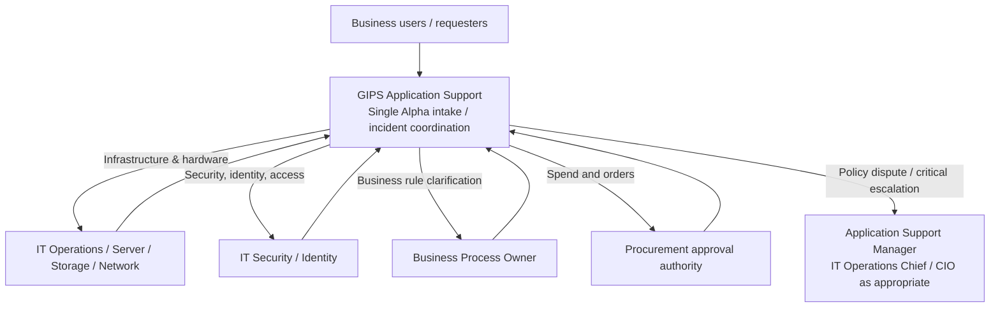

# Alpha Platform — Contact, Ownership and Escalation Matrix

**Prepared:** November 6, 2026 | **Status:** Proposed  
**Instructions:** Fill in **name**, **email/phone**, alternate contact, help-desk queue and on-call hours for each role. Functional roles are placeholders; no individual is assigned merely by appearing in this table.

**Primary routing principle:** All business-to-technical Alpha platform requests and user incidents enter through **GIPS Application Support**. Technical teams retain approval and execution responsibility within their specialty.

| Subject / event | Operational point of contact | Technical executor / decision authority | Business consult / acceptance | Named contact / backup |
|---|---|---|---|---|
| All Alpha application-platform questions | GIPS Application Support Platform Lead | Assigned specialty team | Business Service Owner as needed | [Name / Backup / Contact] |
| Platform incident intake and communications | GIPS Application Support Incident Coordinator | IT Operations / IT Security as applicable | Business Service Owner | [Name / Backup / Contact] |
| Legacy Alpha servers and hardware repairs | GIPS Platform Lead | IT Infrastructure Server Lead | Business Service Owner informed | [Name / Backup / Contact] |
| Windows replacement hardware orders | GIPS Platform Lead / Procurement Liaison | IT Infrastructure sizing; Procurement approving authority | Business Service Owner informed | [Name / Backup / Contact] |
| Physical server installation and rack/stack | GIPS Platform Lead coordinates | IT Infrastructure / Data Center Lead | N/A unless outage impact | [Name / Backup / Contact] |
| CPU/RAM/drive specifications | GIPS Platform Lead coordinates requirements | IT Infrastructure Engineering Lead | Business priorities as needed | [Name / Backup / Contact] |
| Disk drives, LUNs, RAID and storage capacity | GIPS Platform Lead coordinates purchase request | IT Storage Engineering / IT Infrastructure | Business impacts as needed | [Name / Backup / Contact] |
| Shared drives, SMB shares and access paths | GIPS Platform Lead | IT File Services / Storage Administrator | Business validates access | [Name / Backup / Contact] |
| Network, firewall and connectivity | GIPS Platform Lead | IT Network Engineering; IT Security approval where required | Business impact contact | [Name / Backup / Contact] |
| Active Directory groups and user access | GIPS Platform Lead / Access Coordinator | IT Identity / IT Security | Business validates user entitlements | [Name / Backup / Contact] |
| Alpha security boundary / segmentation | GIPS Platform Lead coordinates operational impact | IT Security Architect / Security Operations | Business validates resulting access | [Name / Backup / Contact] |
| Security incident or emergency isolation | GIPS Incident Coordinator notified promptly | IT Security Incident Commander | Business Owner informed | [Name / Backup / Contact] |
| Planned platform maintenance / change window | GIPS Change Coordinator | Implementing IT team; authorized CAB | Business Owner consulted | [Name / Backup / Contact] |
| Application installation and configuration | GIPS Application Support Technical Lead | GIPS Application Support / assigned IT executor | Business Owner for functional impacts | [Name / Backup / Contact] |
| Platform authentication / SSO service | GIPS Application Support Technical Lead | App Support; IT Identity / IT Security for infrastructure controls | Business confirms user outcome | [Name / Backup / Contact] |
| Business rules and domain workflows | Business Process Owner | Business-approved development / implementation team | Business Process Owner approves | [Name / Backup / Contact] |
| Business testing / document-output acceptance | Business Test / Acceptance Lead | App Support coordinates technical support | Business Process Owner approves | [Name / Backup / Contact] |
| Backup and restore infrastructure | GIPS Platform Lead | IT Backup / Storage Operations | Business validates recoverability | [Name / Backup / Contact] |
| COOP / disaster recovery readiness | GIPS Application Recovery Coordinator | IT COOP/DR Infrastructure Lead | Business Continuity Owner | [Name / Backup / Contact] |
| GDPS migration and cutover | GIPS Modernization / Cutover Lead | IT Server, Storage, Network and Security leads | Business Cutover Acceptance Lead | [Name / Backup / Contact] |
| Procurement reconciliation / duplicate orders | GIPS Procurement Liaison | Procurement Officer / funds approver | Business Budget Owner where required | [Name / Backup / Contact] |
| ServiceNow tickets, assets and change records | GIPS Platform Service Coordinator | Assigned IT queue / change owner | Requesting business contact | [Name / Backup / Contact] |
| Platform governance exception / dispute | GIPS Application Support Manager | CIO / delegated management authority | Business management consulted | [Name / Backup / Contact] |

## Executive sponsors and governance roles

| Governance position | Name | Contact | Decision / role |
|---|---|---|---|
| Managing Director | Ravinder Birdi | [Fill in] | Division leadership / endorsement |
| CIO | Sam — surname to confirm | [Fill in] | Final policy / governance authorization |
| IT Operations Chief | Nadine — surname to confirm | [Fill in] | Infrastructure operations coordination |
| GIPS Application Support Manager / Alpha Platform Owner | [Fill in] | [Fill in] | Single platform operational accountability |
| Business Department Head / Alpha Business Owner | [Fill in] | [Fill in] | Business requirements and outcomes |
| IT Security Lead | [Fill in] | [Fill in] | Security policy and security change decisions |
| IT Infrastructure Lead | [Fill in] | [Fill in] | Infrastructure implementation |
| Procurement / Contracts Lead | [Fill in] | [Fill in] | Delegated purchasing approvals |

## Contact and escalation diagram

## Incident priority escalation (fill in assigned channels)
- **Initial contact:** [GIPS Application Support ticket queue / phone]
- **After-hours / critical:** [GIPS on-call channel]; dispatch parallel IT Security/Infrastructure incident response as required.
- **IT Operations duty officer:** [Name / contact]
- **Security incident response:** [Name / contact]
- **Management escalation:** [GIPS manager]; [Nadine]; [Sam] per incident severity and existing rules.
- **Business communications:** [Business owner / distribution list]

Escalation targets and times must follow existing approved IT incident/COOP policy; this matrix does not create new SLAs.

## Reference
Authoritative hardware placement/request files: `Hardware replacment/07 Server Requests/`. Operational authority transfer remains **proposed until signed and communicated**.
